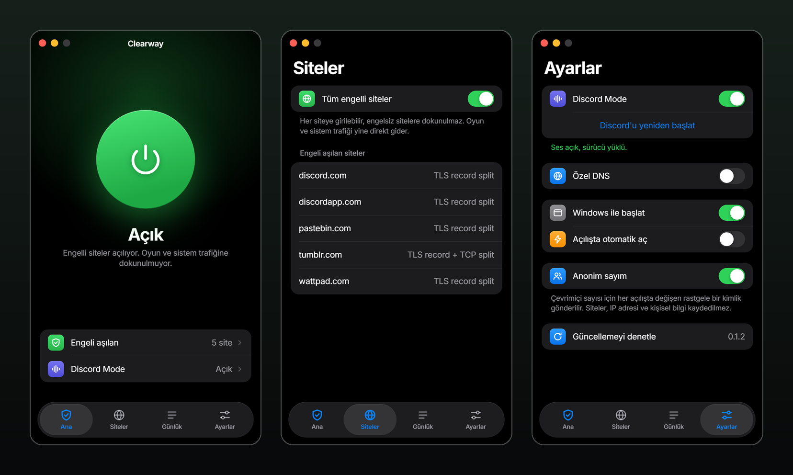

# Clearway

**Engelli sitelere tek dokunuşla girin. Oyunlarınıza dokunmadan.**

DNS zehirlemesini ve SNI engelini aşan, sade bir Windows uygulaması.

### [⬇ Clearway'i indir](https://github.com/o7xMarasli/clearway-releases/releases/latest/download/Clearway-Setup.exe)

Windows 10 ve üstü, 64 bit · yaklaşık 4 MB · [Tüm sürümler](https://github.com/o7xMarasli/clearway-releases/releases)

 

## Neler yapar?

- **Tek düğme:** Aç, kapat. Ayar yapmanız gerekmez.
- **Kendi kendine öğrenir:** Bir site engelliyse çalışan yöntemi bulur ve o site için hatırlar. Yöntem bozulursa sıradakine geçer.
- **Engelsiz sitelere dokunmaz:** Önce normal bağlanmayı dener, gerekirse devreye girer.
- **Zehirli DNS'e kanmaz:** Adresleri şifreli DNS ile çözer. İsterseniz sağlayıcıyı kendiniz seçersiniz.
- **Discord Mode:** Discord'un uygulaması, güncellemesi, sesi ve yayını tek ayarda.
- **Kendini günceller:** Yeni sürüm arka planda iner ve siz oyundayken kurulmaz.
- **Temiz kapanır:** Uygulama çökse bile sistem ayarları eski haline döner. PC aniden kapanırsa bir sonraki oturumda düzeltilir.

## Kurulum

1. [Clearway-Setup.exe](https://github.com/o7xMarasli/clearway-releases/releases/latest/download/Clearway-Setup.exe) dosyasını indirip çalıştırın.
2. Windows "bilgisayarınızı korudu" derse **Ek bilgi → Yine de çalıştır**'a tıklayın. Kurulum dosyası kod imzalı olmadığı için bu uyarı çıkabilir.
3. Clearway'i açın ve büyük düğmeye dokunun.

Yönetici izni istemez. Yalnızca Discord Mode'u açarsanız izin ister.

## Oyunlar ve anti-cheat

Clearway varsayılan olarak **sürücü kurmaz** ve oyun süreçlerine dokunmaz. Microsoft, Xbox, Minecraft, Steam, Epic, Riot ve benzeri platformların alan adları hiçbir zaman Clearway'den geçmez.

Sürücü yalnızca **Discord Mode** açıkken, Discord sesi için kullanılır (WinDivert) ve siz kapatana kadar açık kalır; oyun açılsa da kapanmaz. Bazı anti-cheat'ler (Vanguard, Easy Anti-Cheat, BattlEye gibi) bu tür bir sürücü yüklüyken oyunu açmayabilir ya da sunucudan düşürebilir. Böyle bir durumda oyundan önce Discord Mode'u kapatın.

## Sınırlar

- **IP adresiyle engellenen siteler açılmaz.** Bunun için VPN gerekir.
- **Discord Mode'da** antivirüs WinDivert dosyalarını işaretleyebilir. Bu dosyalar uygulamayla gelmez, Discord Mode'u açınca iner ve yüklenmeden önce doğrulanır.
- **Her güncellemeden sonra** Discord Mode ses sürücüsü için yeniden yönetici izni ister.
- Windows 10'da denenmiştir. Şimdilik yalnızca Windows sürümü var.

## Gizlilik

Clearway çevrimiçi kullanıcı sayısını göstermek için 15 dakikada bir, **her açılışta yeniden üretilen rastgele bir kimlik** gönderir. Sunucuda yalnızca bu kimlik ve son görülme zamanı tutulur, 20 dakika sonra silinir. Hangi siteleri açtığınız gönderilmez; IP adresiniz kaydedilmez. Bu sayım **Ayarlar → Anonim sayım** ile kapatılabilir.

Uygulama ayrıca güncelleme için bu depoya, DNS çözümü için seçili sağlayıcıya bağlanır.

## Sık sorulan sorular

<b>Clearway bir VPN mi?</b>

Hayır. Trafiğiniz başka bir sunucudan geçmez, IP adresiniz değişmez. Bağlantılar kendi internetinizden çıkar; yalnızca engeli tetikleyen ilk paketler farklı biçimde gönderilir.

<b>Bir site açılmıyor, ne yapmalıyım?</b>

Uygulamayı açıp **Günlük** ekranına bakın. "Hiçbir teknik işe yaramadı" yazıyorsa site büyük olasılıkla IP adresiyle engellenmiştir. Sorun devam ederse günlükle birlikte [sorun bildirin](https://github.com/o7xMarasli/clearway-releases/issues).

<b>Başka bir DPI aracıyla birlikte kullanabilir miyim?</b>

Önerilmez. İki araç aynı paketleri değiştirince siteler açılmayabilir. Clearway böyle bir araç açıksa uyarı gösterir.

<b>Nasıl kaldırırım?</b>

Windows Ayarları → Uygulamalar → Clearway → Kaldır. Önce tepsi simgesinden çıkış yapın.

<b>Kaynak kodu nerede?</b>

Kaynak kod şu an açık değil. Bu depo yalnızca sürümleri ve kurulum dosyalarını barındırır. Her sürümün notunda dosyayı doğrulamanız için SHA-256 değeri bulunur.

---

Clearway bağımsız bir projedir; Discord, Microsoft, Valve, Riot veya sözü geçen diğer şirketlerle bağlantısı yoktur. Bulunduğunuz ülkenin yasalarına uymak sizin sorumluluğunuzdadır.

*Clearway bypasses DNS poisoning and SNI filtering on Windows with one click, without touching your games.*
